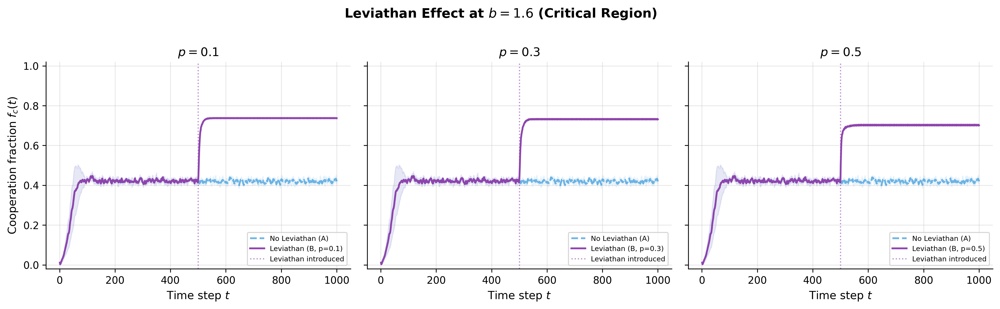

# AI & Computational Modeling Lab

Coursework in network science, ranking algorithms, game theory, and computational social science, developed for *Artificial Intelligence and Computational Thinking* (Spring 2026). Each project has its own methods and run notes; this page is the entry point.

## Projects

| Project | Question and approach |
| --- | --- |
| [Network visualization](hw01-network-visualization/) | Build a weighted character network and explore a Facebook ego network with NetworkX and PyVis. |
| [Network homophily and evolution](hw02-network-homophily/) | Compare gender homophily across 10 ego networks, then answer the slide-deck extension question with a friendship and group-affiliation evolution model. |
| [Small-world networks](hw03-small-world-networks/) | Study distance and degree patterns in Watts-Strogatz and Kleinberg-style networks. |
| [PageRank](hw04-pagerank/) | Implement iterative PageRank and inspect the Web-Google graph. |
| [Game theory](hw05-game-theory/) | Work through two teaching cases with payoff matrices and Nash equilibria. |
| [Final project: Leviathan](final-project/) | Use a spatial evolutionary game to test when centralized punishment sustains cooperation. |

## Featured experiment

The [final project](final-project/README.md) compares a spatial Prisoner's Dilemma with and without punishment of defectors. In the archived course runs, cooperation at `b = 1.6` was about 42% without the intervention and 73% with it. At `b >= 1.8`, the intervention did not restore cooperation after extinction. These are outcomes of this model and parameter sweep, not a general estimate of social behavior.



The current implementation uses periodic eight-neighbor connectivity for both evolution and cluster measurement. The [English technical report](final-project/report/technical_report.md) presents a full rerun under the current implementation. The original course manuscript and figures remain available as historical outputs.

## Run a small check

From the repository root:

```bash
python -m venv .venv
source .venv/bin/activate
python -m pip install -r requirements.txt
python -m unittest discover -s final-project/tests -v
python final-project/src/quick_demo.py
```

The quick demo uses a 20 x 20 grid for 20 steps. It checks the workflow; it does not reproduce the full study. For the 100 x 100, 1,000-step sweep and figure generation, follow the [final-project run guide](final-project/README.md). Other assignments have setup and data instructions in their own README files.

## Repository notes

- Large public datasets are downloaded from their original providers; they are not committed here.
- Randomized experiments use explicit seeds where supported. Saved figures are reference outputs, and source scripts are included for regeneration.
- Original code is available under the [MIT License](LICENSE). External data and research keep their own terms; see [third-party notices](THIRD_PARTY_NOTICES.md).
- The game-theory cases use teaching assumptions and subjective utilities. They are not legal advice or forecasts.
