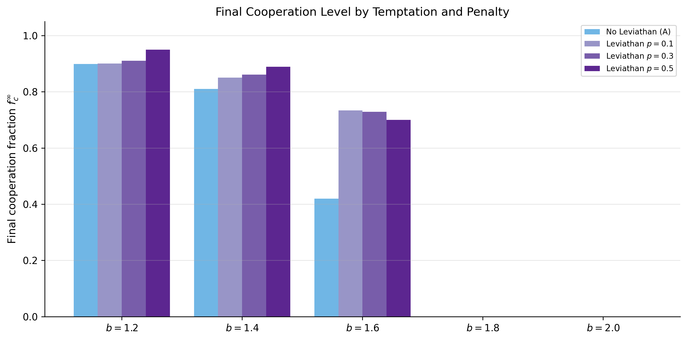
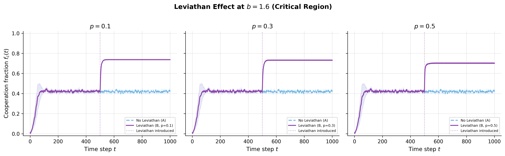
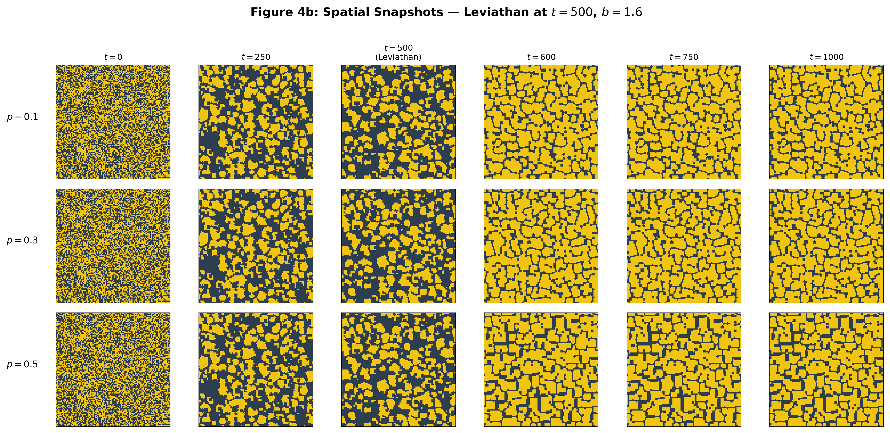
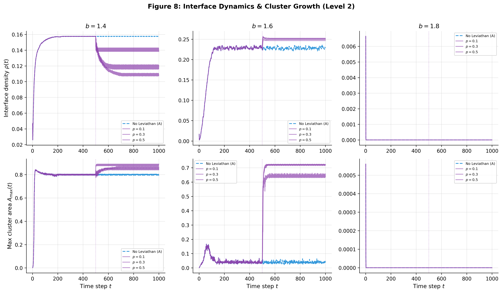
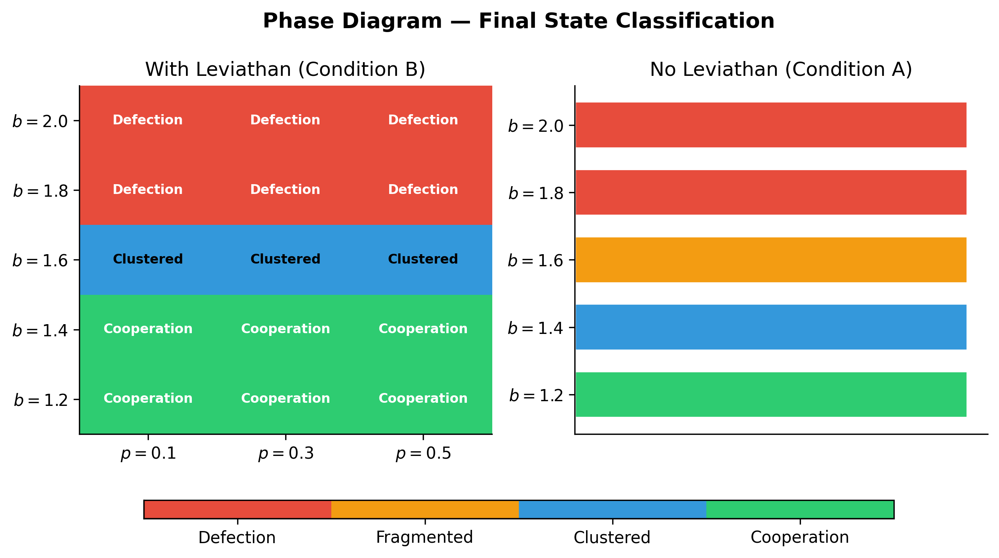

# Leviathan in a Spatial Prisoner's Dilemma

## A computational experiment on cooperation, punishment, and institutional timing

## Abstract

This project turns a claim from Hobbesian political philosophy into a controlled computational experiment. A spatial Prisoner's Dilemma evolves on a periodic 100 x 100 lattice. The baseline condition contains no central authority; the intervention condition introduces a fixed penalty on defectors after the two conditions have shared the same first 500 states. Five temptation values, three penalty levels, and five paired seeds are evaluated over 1,000 transitions.

The intervention has its largest effect in the intermediate regime. At `b = 1.6`, mean cooperation over the final 500 states is 0.420 without the institution and 0.734, 0.729, and 0.700 under penalties of 0.1, 0.3, and 0.5. The institution has smaller positive effects at `b = 1.4` and cannot restore cooperation at `b >= 1.8`, where cooperators disappear before the intervention. The result is therefore conditional: punishment changes a trajectory that still contains viable cooperation, but this model contains no mechanism for recreating a strategy that has already become extinct.

## 1. Research question

Hobbes argues that cooperation remains insecure without a common authority capable of enforcing agreements. That argument can be divided into computational questions:

1. Can cooperation persist through local interaction alone?
2. If a centralized penalty is introduced after the system has already evolved, does it change the trajectory?
3. Does stronger punishment produce a larger effect?
4. Is there a state from which punishment alone cannot recover cooperation?

The experiment does not treat a cellular automaton as a literal model of a state. Its narrower purpose is to expose the assumptions behind one mechanism: a centralized institution changes the relative payoff of defection.

## 2. Model

### 2.1 Spatial environment

Each cell on a periodic square lattice contains either a cooperator (`1`) or a defector (`0`). Initial strategies are assigned independently with equal probability. Every cell interacts with its eight Moore neighbors. Periodic boundaries make the lattice a torus, so cells on opposite edges are adjacent.

### 2.2 Payoffs and update rule

Let `n_c` be the number of cooperating neighbors. A cooperator receives payoff `n_c`; a defector receives `b * n_c`, where `1 < b <= 2` is the temptation to defect. When the institution is active, a penalty `p` is subtracted from each defector's payoff.

The system updates synchronously. Each cell observes itself and its eight neighbors, finds the highest payoff, and copies the corresponding strategy. Self is evaluated first, so exact payoff ties preserve the current strategy. The rule is deterministic after initialization, which makes paired comparisons directly reproducible.

### 2.3 Intervention timing

Baseline and intervention runs use the same seed and evolve under identical rules through state `t = 500`. The penalty then affects the transition from `t = 500` to `t = 501`. This design isolates the intervention from differences in initialization or pre-intervention history.

### 2.4 Measurements

The analysis records four time-varying quantities:

- Cooperation fraction: the share of cooperative cells.
- Cluster count: the number of periodic 8-connected cooperator components.
- Largest-cluster area: the largest cooperator component as a share of the lattice.
- Interface density: the share of horizontal, vertical, and diagonal neighbor pairs whose strategies differ.

Cluster measurement follows the same periodic topology as the evolution rule. Planar components are labeled first; a union-find pass then merges components connected across opposite borders, including diagonal seam contacts.

## 3. Experimental design

The reference experiment uses:

- Grid: 100 x 100 cells.
- Duration: 1,000 transitions.
- Intervention state: `t = 500`.
- Temptation: `b` in `{1.2, 1.4, 1.6, 1.8, 2.0}`.
- Penalty: `p` in `{0.1, 0.3, 0.5}`.
- Repetitions: five paired seeds per parameter combination.

Condition A runs each `b` without an institution. Condition B combines each `b` with all three penalties. The runner also records fixed-time snapshots and serializes raw metric arrays, summaries, metadata, and lattice states. Numeric arrays are stored without object dtypes, so they can be loaded with `allow_pickle=False`.

## 4. Implementation

The model is implemented in Python with NumPy and SciPy. Wrapped convolution counts cooperating neighbors across the full lattice. Payoff and strategy arrays are vectorized; nine aligned arrays represent each cell and its neighborhood, and `argmax` plus `take_along_axis` performs the synchronous imitation step.

The code separates model state, experiment orchestration, persistence, and visualization. It validates parameter ranges and time-series alignment, derives intervention state from the model clock rather than duplicating it in a mutable flag, and provides a small deterministic smoke run. Unit and integration tests cover periodic connectivity, empty and full lattices, deterministic seeds, paired pre-intervention histories, invalid parameters, aligned aggregation, and pickle-free result persistence.

## 5. Results

### 5.1 Baseline cooperation

Mean cooperation over the final 500 states falls as the temptation to defect rises:

| `b` | No institution |
| ---: | ---: |
| 1.2 | 0.899 |
| 1.4 | 0.810 |
| 1.6 | 0.420 |
| 1.8 | 0.000 |
| 2.0 | 0.000 |

At `b = 1.2` and `b = 1.4`, cooperators form large spatial clusters and remain dominant. At `b = 1.6`, cooperation and defection coexist in a changing spatial boundary. At `b >= 1.8`, cooperators disappear early in the run.

### 5.2 Intervention effects

The final-500-state means under the three penalty levels are:

| `b` | Baseline | `p = 0.1` | `p = 0.3` | `p = 0.5` |
| ---: | ---: | ---: | ---: | ---: |
| 1.2 | 0.899 | 0.901 | 0.910 | 0.950 |
| 1.4 | 0.810 | 0.850 | 0.861 | 0.889 |
| 1.6 | 0.420 | 0.734 | 0.729 | 0.700 |
| 1.8 | 0.000 | 0.000 | 0.000 | 0.000 |
| 2.0 | 0.000 | 0.000 | 0.000 | 0.000 |





At `b = 1.6`, the paired trajectories coincide through the intervention state and separate immediately afterward. The cooperation fraction rises by roughly 0.28 to 0.31 relative to the baseline and settles into a cooperator-dominant state. The effect is not monotonic in penalty strength: `p = 0.5` produces a lower final mean than the two smaller penalties. With five deterministic seeds per setting, the experiment establishes a reproducible pattern for this model but does not justify a broad population-level significance claim.

### 5.3 Spatial mechanism

The intervention changes both composition and geometry. At `b = 1.6`, the largest cooperative component expands from a small share of the lattice to well above 0.6 after the penalty begins. The interface density also shifts, indicating that the result is not merely a relabeling of isolated cells; the institution changes how cooperative regions expand and meet defecting regions.





The periodic cluster correction matters when a cooperative region crosses a boundary. Without seam merging, one toroidal cluster can be counted as several planar clusters and its largest area understated. The current measurement now matches the topology used by the update rule.

### 5.4 Boundary of the intervention

The intervention does nothing at `b = 1.8` and `b = 2.0` because cooperation has already reached zero by `t = 500`. The update rule only copies strategies that exist in the local neighborhood; a payoff penalty can make defection less attractive, but it cannot introduce a missing cooperative strategy. The computational boundary therefore follows from the mechanism, not from an unexplained failure of optimization.



## 6. Interpretation

The model supports a qualified version of the institutional claim. Centralized punishment is most consequential in a regime where local cooperation survives but remains vulnerable. In that regime, changing defectors' payoffs allows cooperative clusters to expand. Where cooperation is already robust, the additional institution has less room to improve the outcome. Where cooperation is extinct, the intervention has no recovery channel.

The non-monotonic result at `b = 1.6` also separates the existence of an institution from the simple idea that more punishment is always better. The mechanism is a discontinuous imitation rule: a penalty matters when it changes which neighbor has the maximum payoff. Once rankings cross relevant thresholds, larger subtraction does not translate smoothly into larger aggregate cooperation.

## 7. Limitations

- The institution is imposed externally and has no creation, operating, or legitimacy cost.
- Cells imitate local payoff leaders and do not reason, remember, communicate, or anticipate.
- The lattice is regular and fixed; real social networks are heterogeneous and dynamic.
- The deterministic update rule can create threshold behavior that differs from stochastic or asynchronous evolution.
- Five seeds are enough to reproduce the reported sweep, not to characterize every finite-size or initialization effect.
- Penalty values are tested on a small grid rather than optimized or calibrated to empirical behavior.

These limitations define extensions rather than hidden assumptions. Endogenous institution formation, alternative network structures, stochastic updates, institutional cost, and larger seed sets would each test a different part of the philosophical claim.

## 8. Reproduction

From the repository root:

```bash
python -m venv .venv
source .venv/bin/activate
python -m pip install -r requirements.txt
python -m unittest discover -s final-project/tests -v
python final-project/src/quick_demo.py
cd final-project/src
python -u run_experiments.py
python visualization.py
```

The full run used for this report completed 100 parameter/repetition runs plus snapshot collection in approximately 161 seconds on the maintenance environment. Generated arrays remain outside version control; selected figures are committed for inspection.
