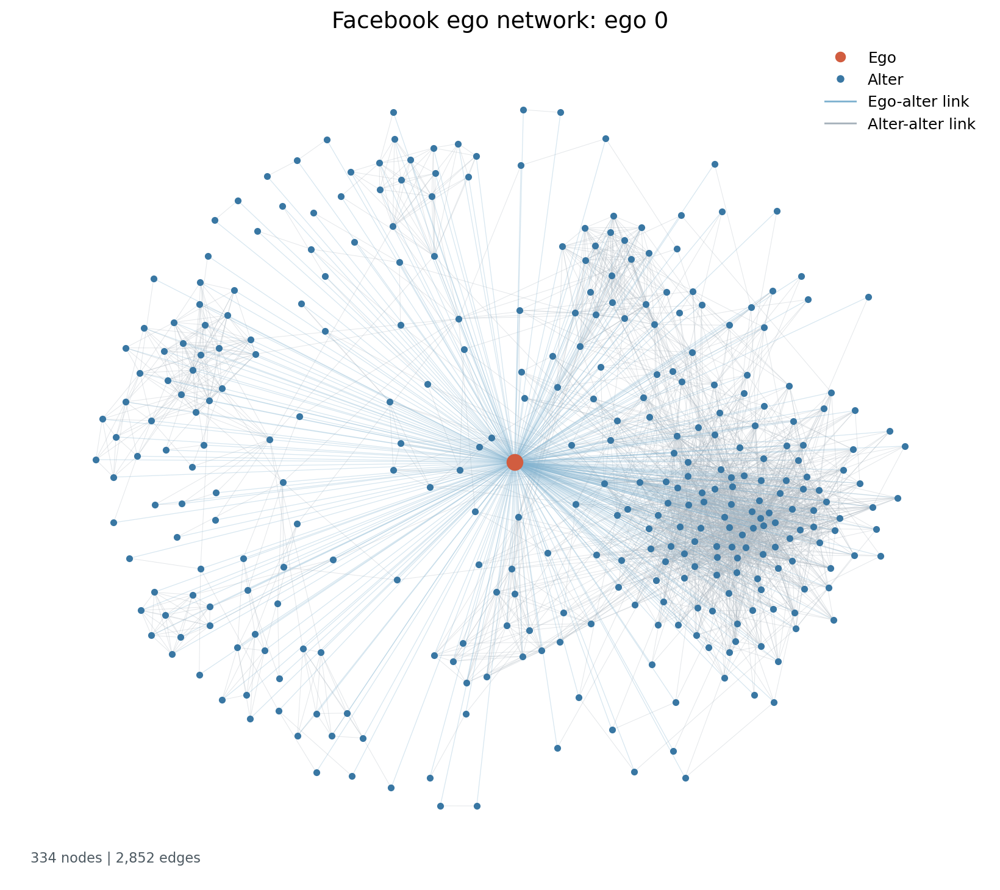
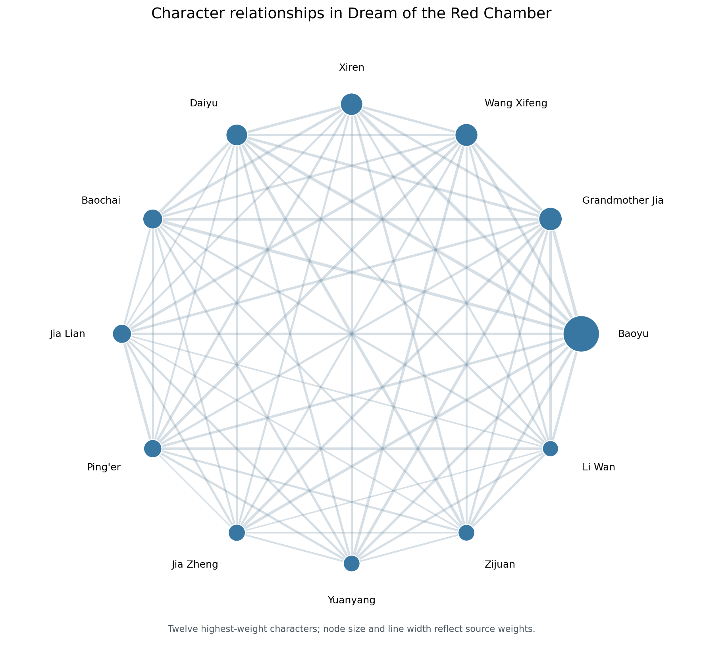

# Network visualization

Two networks are constructed from edge lists and displayed with NetworkX and
PyVis:

1. A Facebook ego network built from the anonymized `0.edges` edge list. The
   ego is connected to every alter appearing in the list.
2. A weighted character network from *Dream of the Red Chamber*. Node size
   and edge width encode the weights supplied in the relationship tables.



The preview above has 334 nodes and 2,852 edges. It includes alters appearing
in `0.edges`; the separate homophily analysis also considers alters listed
only in the feature file, so its node count differs.



The character preview shows the twelve highest-weight nodes and the edges
between them. The interactive version includes the full source network and
retains the original Chinese character names.

## Run

Install the repository requirements first. From the repository root:

```bash
python hw01-network-visualization/facebook_ego_network.py
python hw01-network-visualization/honglou_network.py
python hw01-network-visualization/render_previews.py
```

The required `data/0.edges`, `data/NameNode.csv`, and `data/relationship.csv` files are included in this assignment. Interactive HTML files are written to the assignment's `results/` directory. The preview script produces
the two static figures above; the original PDF exports are also included.

The Facebook edge list is from the SNAP Facebook Social Circles dataset. The two CSV relationship tables are derived analytical data; the underlying literary text is not redistributed.
