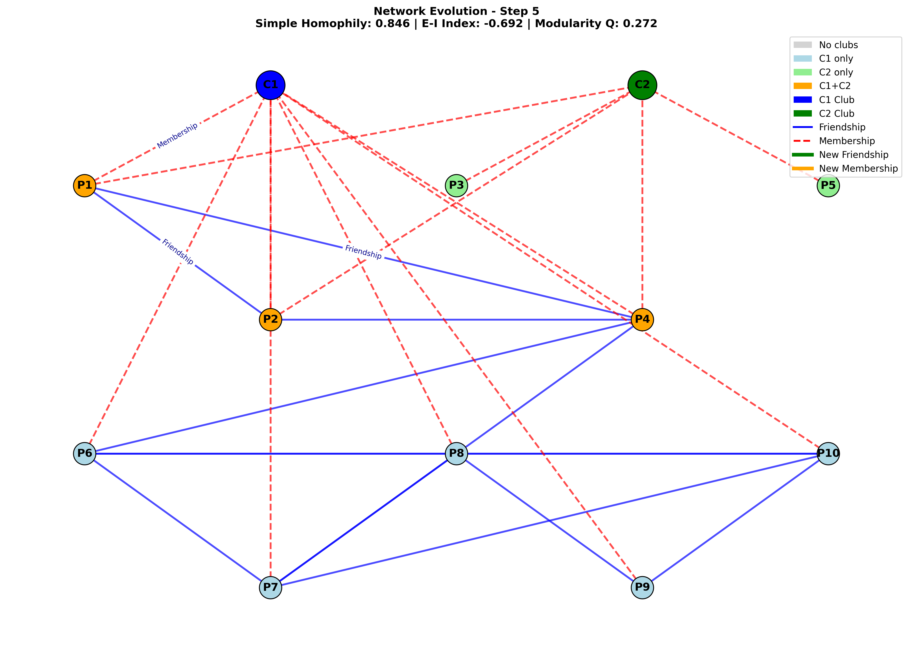

# Network homophily and evolution

This project studies two questions: whether friends in Facebook ego networks
share the same recorded gender feature more often than a population baseline
predicts, and how friendship and club membership can evolve together.

The Facebook analysis compares the observed share of same-category edges with
the expected share under random matching of nodes with known features. Across
the ten recorded ego networks, the observed share exceeds that baseline.

The evolution model begins with ten people and two clubs. Two people become
friends if they have at least three mutual friends or belong to both clubs;
someone joins a club when at least two friends already belong to it. At each
step, the program records new links, draws the network, and measures same-group
edge share, the E-I index, and modularity across four membership categories.
Friendship rules are applied before the club-joining rule within each step.



The [results](results/analysis.md) explain the baseline, update order, and
measurements, and show the network at each step.

## Data

Download `facebook.tar.gz` from the [SNAP Facebook Social Circles page](https://snap.stanford.edu/data/ego-Facebook.html), extract it, and place the dataset at:

```text
hw02-network-homophily/data/facebook/
```

## Run

After installing the repository requirements, run from the repository root:

```bash
python hw02-network-homophily/ego0_homophily.py
python hw02-network-homophily/compare_ego_networks.py
python hw02-network-homophily/network_evolution.py
```

The first two commands require the SNAP files above. The evolution simulation and `python -m unittest discover -s hw02-network-homophily/tests -v` do not require a dataset download. The simulation replaces network images in this assignment's `results/` directory.

The gender-feature scripts share one implementation and accept `--data-dir`
to analyze a dataset stored elsewhere. SNAP anonymizes feature categories; the
analysis does not infer the labels of those categories.
