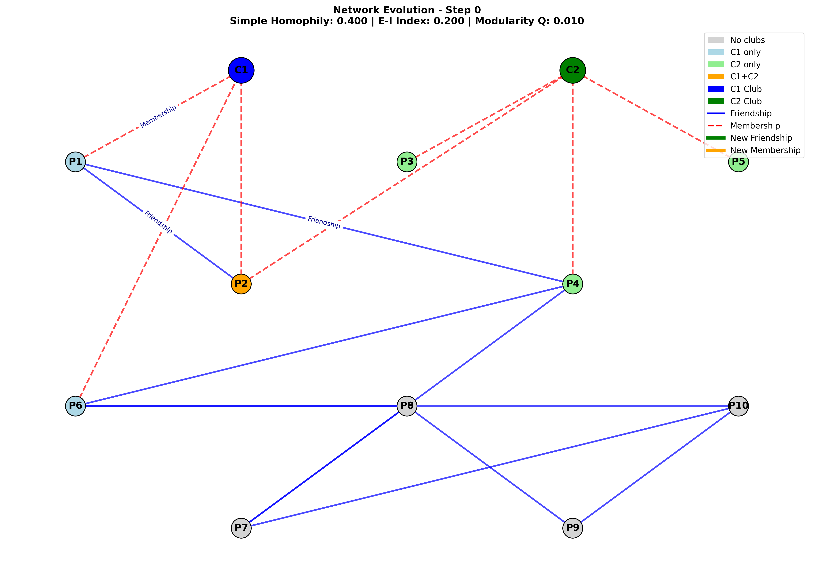
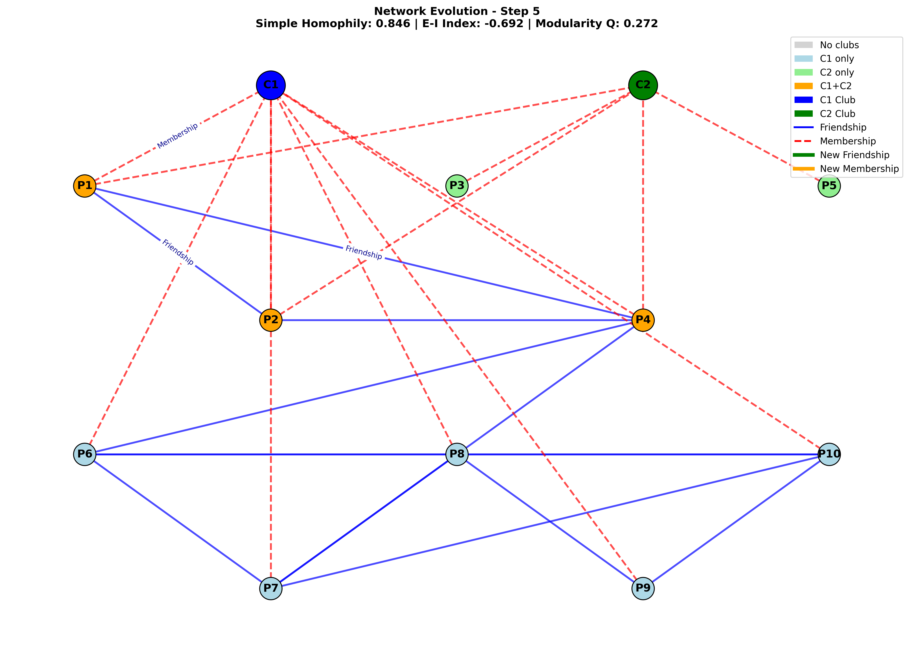

# Network homophily and evolution: results

## Gender-feature homophily in Facebook ego networks

For each ego network, the analysis combines alter-to-alter edges with edges
from the ego to every alter listed in its feature file. Edges whose endpoints
do not both have known gender features are excluded. The observed statistic
is the fraction of valid edges connecting nodes in the same category. The
baseline is the sum of squared category shares among nodes with known features;
the excess is observed minus expected.

| Ego ID | Nodes with known features | Valid edges | Observed | Expected | Excess |
| ---: | ---: | ---: | ---: | ---: | ---: |
| 0 | 342 | 2,776 | 0.5933 | 0.5287 | 0.0646 |
| 107 | 1,034 | 27,380 | 0.5777 | 0.5479 | 0.0298 |
| 348 | 225 | 3,371 | 0.6873 | 0.6446 | 0.0427 |
| 414 | 154 | 1,830 | 0.6333 | 0.5918 | 0.0415 |
| 686 | 163 | 1,660 | 0.5584 | 0.5137 | 0.0447 |
| 698 | 65 | 320 | 0.5813 | 0.5342 | 0.0470 |
| 1684 | 777 | 14,407 | 0.5729 | 0.5427 | 0.0302 |
| 1912 | 747 | 29,858 | 0.5177 | 0.5001 | 0.0176 |
| 3437 | 526 | 4,686 | 0.5973 | 0.5235 | 0.0738 |
| 3980 | 58 | 195 | 0.7641 | 0.6165 | 0.1476 |

All ten networks show positive excess under this baseline. The comparison is
descriptive: the SNAP features are anonymized and missing attributes are
excluded, so these values do not establish why connections formed.

## Friendship and club-membership evolution

The simulation starts with a ten-person friendship graph and two clubs. Two
people form a friendship if they have at least three mutual friends or share
both clubs. A person joins a club if at least two friends belong to it. Each
step applies the friendship rules first, then the club rule; a new friendship
can therefore influence club membership in that same step. This update order
is part of the implementation and can differ from a fully simultaneous model.
For the initial network shown here, both update orders produce the same steps.

Initial friendship matrix, with rows and columns corresponding to P1-P10:

```text
0 1 0 1 0 0 0 0 0 0
1 0 0 0 0 0 0 0 0 0
0 0 0 0 0 0 0 0 0 0
1 0 0 0 0 1 1 0 0 0
0 0 0 0 0 0 0 0 0 0
0 0 0 1 0 0 0 1 0 1
0 0 0 1 0 0 0 1 0 1
0 0 0 0 0 1 1 0 1 0
0 0 0 0 0 0 0 1 0 1
0 0 0 0 0 1 1 0 1 0
```

Initial club memberships: P1 and P6 belong to C1; P2 belongs to both clubs;
P3, P4, and P5 belong to C2; P7-P10 do not belong to either club.

| Step | New friendships | New club memberships | Same-group edge share | E-I index | Modularity Q |
| ---: | --- | --- | ---: | ---: | ---: |
| 0 | - | - | 0.400 | 0.200 | 0.010 |
| 1 | P6-P7; P8-P10 | P1-C2; P4-C1 | 0.583 | -0.167 | 0.153 |
| 2 | P2-P4 | P7-C1 | 0.538 | -0.077 | 0.201 |
| 3 | - | P8-C1; P10-C1 | 0.692 | -0.385 | 0.213 |
| 4 | - | P9-C1 | 0.846 | -0.692 | 0.272 |
| 5 | - | - | 0.846 | -0.692 | 0.272 |

The network reaches a fixed point at step 5. The same-group edge share is the
proportion of friendship edges connecting people with the same club-membership
pattern. The E-I index is `(external edges - internal edges) / all friendship
edges`. Modularity Q uses the standard degree-based null model for the four
membership categories, calculated with NetworkX.

The earlier class-size-based score remains available as `original_score` in
the code. It ranged from 0.275 at step 0 to 0.662 at step 5, but it is not
Newman modularity and is not labeled as such in the updated figures.





Intermediate states: [step 1](network_step_1.png), [step 2](network_step_2.png),
[step 3](network_step_3.png), [step 4](network_step_4.png).

Final friendship matrix:

```text
0 1 0 1 0 0 0 0 0 0
1 0 0 1 0 0 0 0 0 0
0 0 0 0 0 0 0 0 0 0
1 1 0 0 0 1 1 0 0 0
0 0 0 0 0 0 0 0 0 0
0 0 0 1 0 0 1 1 0 1
0 0 0 1 0 1 0 1 0 1
0 0 0 0 0 1 1 0 1 1
0 0 0 0 0 0 0 1 0 1
0 0 0 0 0 1 1 1 1 0
```

At convergence, P1, P2, and P4 belong to both clubs; P3 and P5 belong to C2;
and P6-P10 belong to C1.
