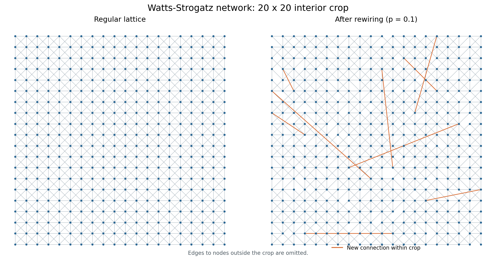

# Small-world networks

This project compares two spatial network models:

- `watts_strogatz.py`: rewires an eight-neighbor periodic lattice and measures shortest-path and clustering behavior.
- `watts_strogatz_kleinberg.py`: adds distance-dependent long-range links and fits the frequencies of occupied distance bins.

The recorded 10,000-node Watts-Strogatz run produced an average path length of 6.45 and an average clustering coefficient of 0.3171 at a rewiring probability of 0.1. In the WSK run, a log-log fit to distance-bin frequencies had a slope of approximately `-1.8125`. The rank in that plot is an ordinal distance-bin index, not the rank of individual neighbors.



The [results](results/analysis.md) describe the recorded runs, chart data, and interpretation of the fitted slope.

## Rebuild the reference figures

After installing the root requirements, run from the repository root:

```bash
python hw03-small-world-networks/render_reference_figures.py
python -m unittest discover -s hw03-small-world-networks/tests -v
```

This uses the committed numeric extracts in `data/` and replaces the reference PNGs in this assignment's `results/` directory without rerunning a network simulation.

## Run new simulations

```bash
python hw03-small-world-networks/watts_strogatz.py
python hw03-small-world-networks/watts_strogatz_kleinberg.py
```

Both simulations are computationally expensive at the default 100 x 100 scale. Their command-line entry points do not set a random seed, so a new realization can differ from the recorded results. Outputs are written to `results/runs/ws/` and `results/runs/wsk/` relative to this assignment; subsequent runs replace files there. The published reference figures use the archived extracts instead of a fresh realization.
