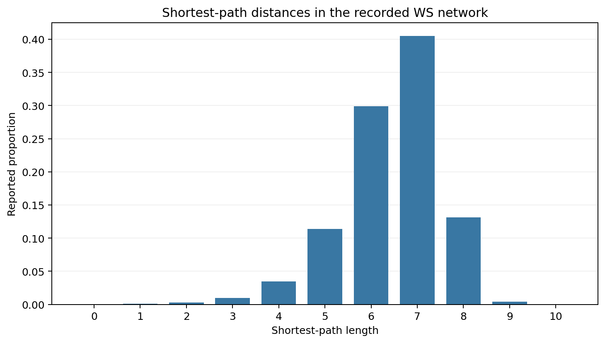
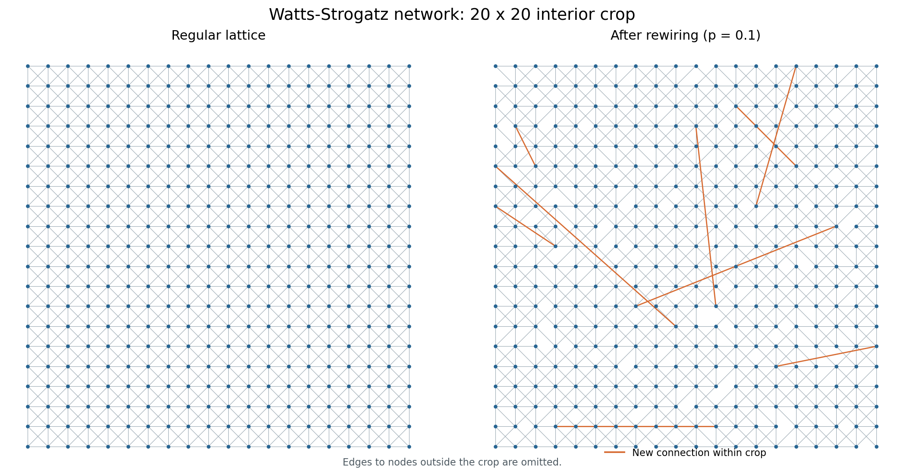
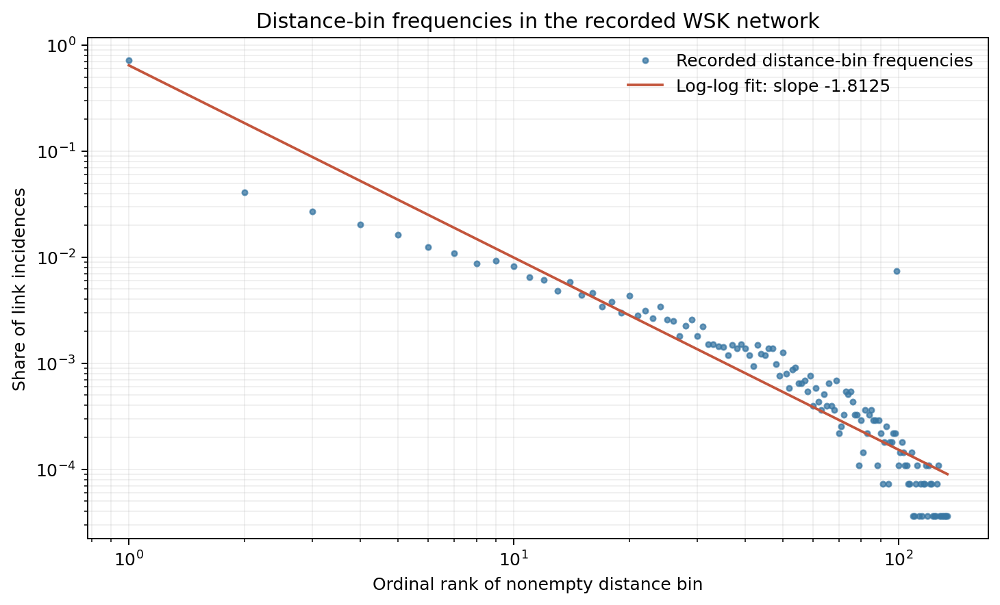

# Small-world network results

## Watts-Strogatz network

The recorded run uses a 100 x 100 periodic lattice with 10,000 nodes and
40,000 edges. At rewiring probability 0.1, its average shortest-path length is
6.45 and its average clustering coefficient is 0.3171.

### Shortest-path distribution

| Distance | Reported proportion |
|----------|-------------|
| 0 | 0.000100 |
| 1 | 0.000800 |
| 2 | 0.002692 |
| 3 | 0.009574 |
| 4 | 0.034433 |
| 5 | 0.113682 |
| 6 | 0.299090 |
| 7 | 0.404704 |
| 8 | 0.131002 |
| 9 | 0.004015 |
| 10 | 0.000007 |

The table and figure preserve the recorded proportions. The original run
included self-pairs in its counts but divided by `n * (n - 1)`, so the values
sum to approximately 1.0001 rather than exactly 1. The current implementation
excludes self-pairs. The observed path lengths are properties of this particular
generated network.

### Network structure

The right panel uses the edges inside the same 20 x 20 region as the recorded
100 x 100 run; edges leaving the region are omitted. Orange lines indicate new
connections within the crop. The regular panel shows the corresponding local
eight-neighbor lattice before rewiring.

## Distance-dependent network

The recorded WSK run uses 10,000 nodes, 27,598 edges, and distance exponent
`alpha = 2.0`. The plot below summarizes the distances of observed links.
Its horizontal coordinate is the ordinal index of each nonempty Manhattan-
distance bin, not the rank of an individual person's neighbor. The line is a
log-log fit to the observed bin frequencies, with slope approximately
`-1.8125`. This fitted value describes this implementation and does not by
itself establish a theoretical rank-based law.

The model wraps local lattice neighbors at the boundary but computes the
Manhattan distances used for the long-range sampling and the plot without
wrapping. This convention contributes to the shape of the recorded distribution
and should be considered when comparing it with other implementations.

### Recorded distance-bin frequencies

Each row is the proportion of the 55,196 link incidences in that bin. The
table retains the original six-decimal output.

| Rank | Probability |
|------|-------------|
| 1 | 0.717443 |
| 2 | 0.040909 |
| 3 | 0.026995 |
| 4 | 0.020436 |
| 5 | 0.016306 |
| 6 | 0.012501 |
| 7 | 0.010907 |
| 8 | 0.008733 |
| 9 | 0.009276 |
| 10 | 0.008225 |
| 11 | 0.006450 |
| 12 | 0.006124 |
| 13 | 0.004783 |
| 14 | 0.005870 |
| 15 | 0.004421 |
| 16 | 0.004638 |
| 17 | 0.003406 |
| 18 | 0.003768 |
| 19 | 0.002971 |
| 20 | 0.004348 |
| 21 | 0.002826 |
| 22 | 0.003116 |
| 23 | 0.002645 |
| 24 | 0.003442 |
| 25 | 0.002573 |
| 26 | 0.002500 |
| 27 | 0.001812 |
| 28 | 0.002247 |
| 29 | 0.002573 |
| 30 | 0.001812 |
| 31 | 0.002210 |
| 32 | 0.001522 |
| 33 | 0.001522 |
| 34 | 0.001449 |
| 35 | 0.001413 |
| 36 | 0.001196 |
| 37 | 0.001486 |
| 38 | 0.001377 |
| 39 | 0.001522 |
| 40 | 0.001377 |
| 41 | 0.001196 |
| 42 | 0.000942 |
| 43 | 0.001486 |
| 44 | 0.001232 |
| 45 | 0.001196 |
| 46 | 0.001377 |
| 47 | 0.001377 |
| 48 | 0.000978 |
| 49 | 0.000761 |
| 50 | 0.001268 |
| 51 | 0.000797 |
| 52 | 0.000580 |
| 53 | 0.000870 |
| 54 | 0.000906 |
| 55 | 0.000652 |
| 56 | 0.000652 |
| 57 | 0.000688 |
| 58 | 0.000544 |
| 59 | 0.000761 |
| 60 | 0.000399 |
| 61 | 0.000580 |
| 62 | 0.000435 |
| 63 | 0.000362 |
| 64 | 0.000507 |
| 65 | 0.000399 |
| 66 | 0.000652 |
| 67 | 0.000399 |
| 68 | 0.000362 |
| 69 | 0.000688 |
| 70 | 0.000217 |
| 71 | 0.000254 |
| 72 | 0.000326 |
| 73 | 0.000544 |
| 74 | 0.000507 |
| 75 | 0.000544 |
| 76 | 0.000435 |
| 77 | 0.000326 |
| 78 | 0.000326 |
| 79 | 0.000109 |
| 80 | 0.000290 |
| 81 | 0.000145 |
| 82 | 0.000362 |
| 83 | 0.000217 |
| 84 | 0.000326 |
| 85 | 0.000362 |
| 86 | 0.000290 |
| 87 | 0.000290 |
| 88 | 0.000109 |
| 89 | 0.000290 |
| 90 | 0.000217 |
| 91 | 0.000072 |
| 92 | 0.000181 |
| 93 | 0.000254 |
| 94 | 0.000072 |
| 95 | 0.000181 |
| 96 | 0.000181 |
| 97 | 0.000217 |
| 98 | 0.000217 |
| 99 | 0.007392 |
| 100 | 0.000109 |
| 101 | 0.000145 |
| 102 | 0.000181 |
| 103 | 0.000145 |
| 104 | 0.000109 |
| 105 | 0.000109 |
| 106 | 0.000072 |
| 107 | 0.000072 |
| 108 | 0.000145 |
| 109 | 0.000036 |
| 110 | 0.000036 |
| 111 | 0.000072 |
| 112 | 0.000109 |
| 113 | 0.000036 |
| 114 | 0.000072 |
| 115 | 0.000036 |
| 116 | 0.000072 |
| 117 | 0.000072 |
| 118 | 0.000109 |
| 119 | 0.000036 |
| 120 | 0.000109 |
| 121 | 0.000072 |
| 122 | 0.000072 |
| 123 | 0.000036 |
| 124 | 0.000036 |
| 125 | 0.000036 |
| 126 | 0.000072 |
| 127 | 0.000109 |
| 128 | 0.000036 |
| 129 | 0.000036 |
| 130 | 0.000036 |
| 131 | 0.000036 |
| 132 | 0.000036 |
| 133 | 0.000036 |
| 134 | 0.000036 |
