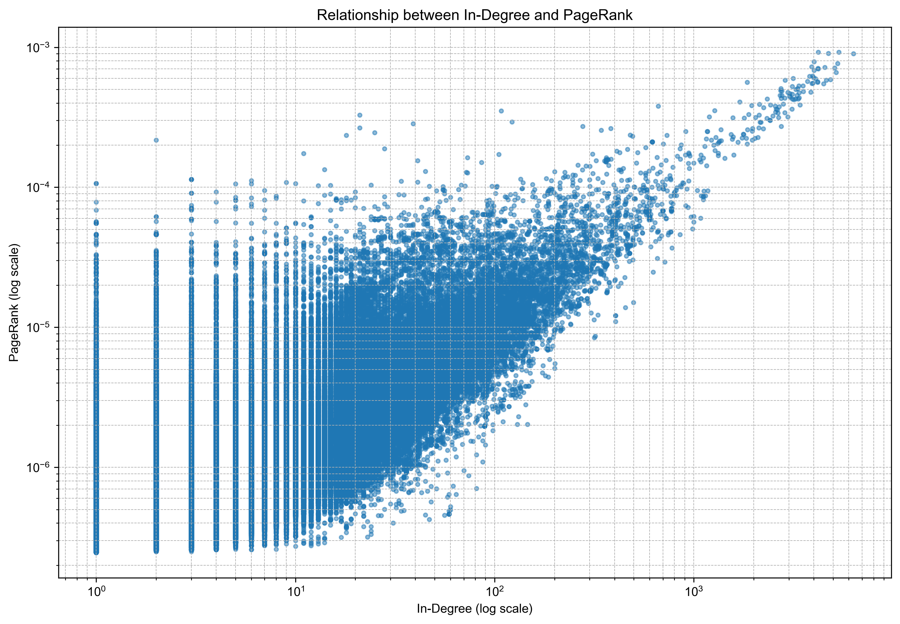

# PageRank on Web-Google

## Recorded results

The recorded run processes 875,713 nodes and 5,105,039 directed edges from
the SNAP Web-Google graph. Its ten highest PageRank scores are:

| Node | PageRank |
| ---: | ---: |
| 597621 | 0.000924 |
| 41909 | 0.000921 |
| 163075 | 0.000904 |
| 537039 | 0.000899 |
| 384666 | 0.000787 |
| 504140 | 0.000765 |
| 486980 | 0.000725 |
| 605856 | 0.000718 |
| 32163 | 0.000713 |
| 558791 | 0.000709 |

Node 558791 is the tenth highest in this list, not the lowest-scoring node in
the full graph. Scores are small because PageRank mass is distributed across
the graph's large number of nodes.



The scatter plot shows a positive association between in-degree and PageRank,
with substantial variation among nodes of the same in-degree. A node's score
also depends on the scores and outgoing links of the nodes pointing to it.
The logarithmic x-axis cannot show nodes with zero in-degree.

## Algorithm and data flow

`read_graph` scans the edge file, sorts the node IDs, and maps each ID to an
array index. A second pass constructs source and destination index arrays and
computes in-degree and out-degree. Keeping only actual edges avoids allocating
an `n x n` dense adjacency matrix.

`pagerank` initializes each node to `1 / n`. On every iteration it distributes
the damped score of each non-sink node across its outgoing edges with
`numpy.add.at`, redistributes sink-node mass uniformly, and adds the uniform
teleportation term. It stops when the L2 norm of the score change falls below
`1e-6` or after 100 iterations. The default damping factor is `0.85`.

```text
edge list -> indexed edge arrays and degrees -> iterative PageRank
          -> top-ranked nodes and in-degree scatter plot
```

The edge arrays and node-level vectors require `O(n + m)` memory for `n`
nodes and `m` edges. Each PageRank iteration performs `O(n + m)` work;
preparation also sorts the node IDs. The figure and table are reference
outputs from the full-data run.
